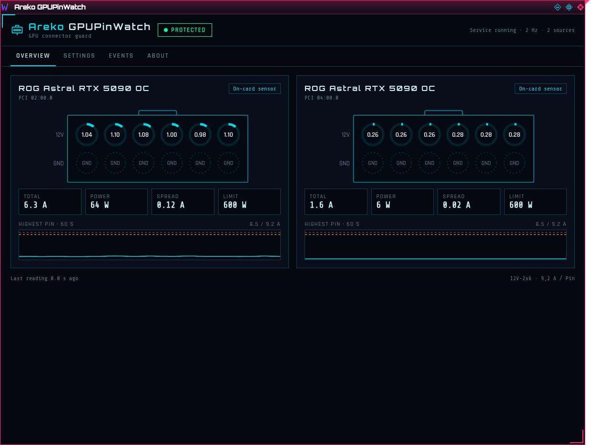
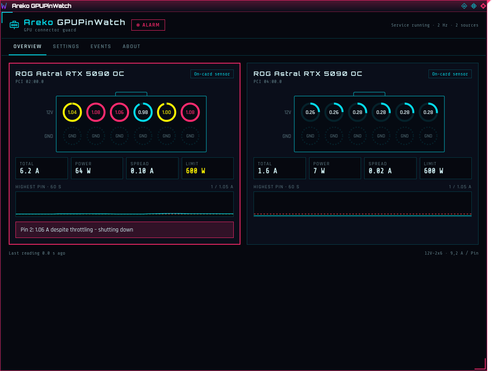
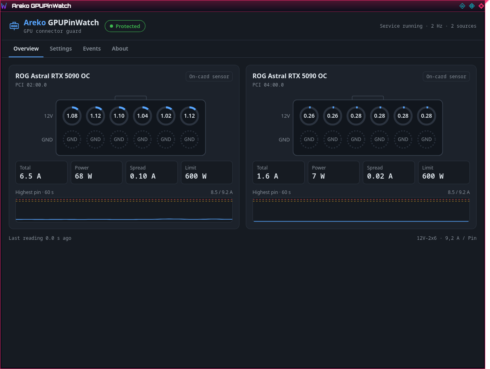
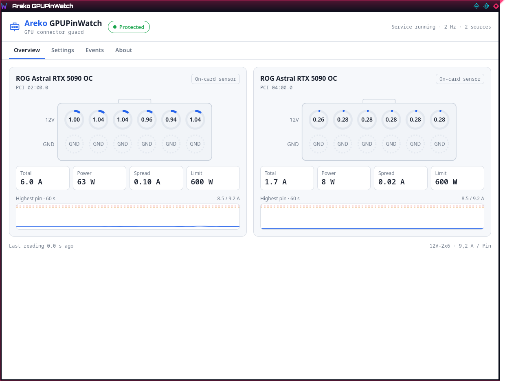

<p align="center"></p>

<h1 align="center">Areko GPUPinWatch</h1>

<p align="center"><b>Wächter für die Pin-Ströme des 12V-2x6-Steckers von RTX-5090-Karten – Linux &amp; Windows</b><br>
<a href="README.md">English</a></p>

Geschmolzene 12V-2x6-/12VHPWR-Stecker fangen meist damit an, dass **ein Pin viel mehr Strom trägt als die anderen**
(schlechter Kontakt, ausgeleierter Stecker). Die meisten Karten sehen das nicht: Alle sechs 12-V-Pins enden hinter dem
Stecker in einer Kupferfläche. Areko GPUPinWatch liest die Karten und Geräte aus, die **jeden Pin einzeln messen**, und
greift ein, bevor es heiß wird.



## Was es tut

| | |
|---|---|
| **Überwacht** | die sechs 12-V-Pins jeder unterstützten Karte, 2× pro Sekunde (1/2/4 Hz) |
| **Stufe 1 – drosseln** | ein Pin ≥ **8,5 A** für 1 s → nur die Leistungsgrenze *dieser* Karte sinkt (Standard 400 W) |
| **Stufe 2 – Notabschaltung** | nach der Drosselung weiter ≥ **9,2 A** (Pin-Nennwert) für 1,5 s → der PC fährt herunter (oder nur Alarm, einstellbar), ein Protokoll wird geschrieben |
| **Alarm** | Taskleisten-Symbol wird gelb/rot und blinkt, Desktop-Meldung, Warnton, die Karte im Fenster pulsiert rot |
| **Freigeben** | ein Klick gibt einer gedrosselten Karte ihre vorherige Grenze zurück |
| **Fenster** | Übersicht mit Stecker (12-V-Reihe + GND-Reihe), Summen, Spreizung, 60-s-Verlauf, Einstellungen, Ereignisse |
| **Aussehen** | Designs **Light, Dark, Areko** · Sprachen **Deutsch, English, Italiano, Español, Português, 中文, 日本語** |

Alle Schwellen sind in den Einstellungen änderbar (innerhalb sicherer Grenzen). Der Dienst läuft auch ohne
angemeldeten Nutzer; das Fenster ist nur die Anzeige.

| Alarm | Dark | Light |
|---|---|---|
|  |  |  |

## Unterstützte Hardware

Werte pro Pin gibt es nur, wo Hardware sie misst. GPUPinWatch erkennt alles automatisch – nichts einzustellen.

### Karten mit Sensor auf der Karte (mit jedem Netzteil)

ASUS-Karten mit dem Messchip ITE IT8915FN. Erkannt wird über die Antwort des Chips, nicht übersehene Varianten laufen also auch.

| Karte | PCI-Subsystem `1043:` | Stand |
|---|---|---|
| ROG Astral RTX 5090 OC | 89E3 | ✅ getestet (Linux, 2 Karten) |
| ROG Astral RTX 5090D OC | 89EA | sollte gehen, ungetestet |
| ROG Astral LC RTX 5090 | 89EC | sollte gehen, ungetestet |
| ROG Astral RTX 5090 OC White | 8A2E | sollte gehen, ungetestet |
| ROG Astral RTX 5090 BTF OC | 8A5A, 8A3C | sollte gehen (nur bei Strom über die 12V-2x6-Buchse) |
| ROG Matrix RTX 5090 | 8A61 | sollte gehen, ungetestet |
| ROG Astral RTX 5080 / OC / OC White / Hatsune Miku | 89DF, 89DE, 8A2B, 8A45 | sollte gehen, ungetestet |

### Jede RTX 5090 mit einem dieser Geräte

| Gerät | Anschluss | Stand |
|---|---|---|
| Thermal Grizzly **WireView Pro II** (+ Noctua Edition) | USB (seriell) | nach dokumentiertem Protokoll umgesetzt, ohne Gerät ungetestet |
| MSI-Netzteil **MPG Ai1300TS PCIE5 / Ai1600TS PCIE5** (GPU Safeguard+) | USB (HID), bis zu 2 Anschlüsse | nach dokumentiertem Protokoll umgesetzt, ohne Gerät ungetestet |

Bei WireView und MSI-Netzteil findet GPUPinWatch selbst heraus, welche Karte am Anschluss hängt
(Vergleich des gemessenen Stroms mit der Leistungsaufnahme jeder Karte).

### Nicht unterstützt – und warum

- **Andere RTX-5090-Karten ohne eines der Geräte oben** (Founders Edition, TUF, Prime, Gigabyte, Zotac, Palit, PNY,
  Inno3D, MSI Gaming/Vanguard/Suprim, …): Die Karte misst nur den *Gesamt*strom, es gibt keine Werte pro Pin.
- **MSI MAG A1000PLS / A1200PLS**: Schutz nur im Netzteil (Summer), keine Daten über USB.
- **Cooler Master GPU Shield**: misst pro Pin, hat aber keine USB-/Software-Schnittstelle.

Masse-Pins (GND) misst keiner dieser Sensoren.

## Installation

### Windows 10 / 11

1. `Areko-GPUPinWatch-<version>-windows-x64.zip` unter [Releases](../../releases) laden und entpacken.
2. Doppelklick auf **`install.cmd`** (Windows fragt nach Administratorrechten). Oder in einer Admin-PowerShell:
   `powershell -ExecutionPolicy Bypass -File .\install.ps1`
   Das kopiert alles nach `C:\Program Files\Areko GPUPinWatch`, richtet den Dienst **Areko GPUPinWatch** ein
   (startet mit Windows) und legt das Fenster ins Startmenü.
3. Entfernen: Doppelklick auf **`uninstall.cmd`**.

Die Dateien sind noch nicht signiert – SmartScreen fragt evtl. einmal („Weitere Informationen“ → „Trotzdem ausführen“).
Einstellungen: `%ProgramData%\Areko GPUPinWatch\config.toml`.

### Linux

Braucht den NVIDIA-Treiber (NVML) und für ASUS-Karten das Modul `i2c-dev` (der Installer schaltet es ein).

1. `Areko-GPUPinWatch-<version>-linux-x64.tar.gz` unter [Releases](../../releases) laden und entpacken.
2. `sudo ./install.sh` – richtet den Dienst `areko-gpupinwatch` (systemd, root) und das Fenster
   `areko-gpupinwatch` mit Menüeintrag ein und lädt `i2c-dev` beim Start.
3. Entfernen: `sudo ./install.sh --entfernen`

Einstellungen: `/etc/areko-gpupinwatch/config.toml`. Eine gedrosselte Karte gibst du im Fenster frei oder mit
`sudo systemctl restart areko-gpupinwatch` (alte Grenze kommt zurück).

### Gefahrlos ausprobieren

`areko-gpupinwatchd --probe` führt die ganze Logik aus, setzt aber nie eine Grenze und fährt nie herunter –
es protokolliert nur, was es *täte*. Mit niedrigen Testwerten wie `--probe --warn 1.0 --crit 1.05` siehst du beide Stufen ohne echte Last.

## Selbst bauen

```bash
# Linux: Rust (stable), webkit2gtk4.1, libsoup3, libappindicator-gtk3 (Fedora: *-devel-Pakete)
cargo build --release                       # Dienst + Fenster
sudo packaging/linux/install.sh             # nimmt target/release
# Windows-Programme unter Linux: mingw64-gcc + rust-std für x86_64-pc-windows-gnu
cargo build --release --target x86_64-pc-windows-gnu
```

Aufbau: `crates/gpw-core` (Decoder, Schutzlogik, IPC – ohne I/O), `crates/gpw-sources` (Gerätezugriff),
`crates/gpw-daemon` (Dienst), `app/` (Fenster, Tauri 2). Protokollfakten: [docs/PROTOKOLLE.md](docs/PROTOKOLLE.md).
Das Programm sendet Geräten **nur lesende** Befehle (Erlaubtlisten im Code).

## Hinweis

Areko GPUPinWatch ersetzt keinen korrekt eingesteckten Stecker und keine guten Kabel. Es reagiert auf das, was die
Sensoren melden; schon entstandene Schäden sieht es nicht. Nutzung auf eigene Gefahr.

## Lizenz

[PolyForm Noncommercial 1.0.0](LICENSE.md) – kostenlos für private und nicht-kommerzielle Nutzung; kommerzielle Nutzung
nur mit Erlaubnis des Autors.

Required Notice: Copyright Areko (https://github.com/arekown/Areko-GPUPinWatch)

Ein Dankeschön für die Protokoll-Vorarbeit an: vhpwr-guard · LACT · LibreHardwareMonitor · PinSentinel ·
wireview-pro-ii · wireview-monitor · meltalarm · psutop · msi-psu-monitor.
