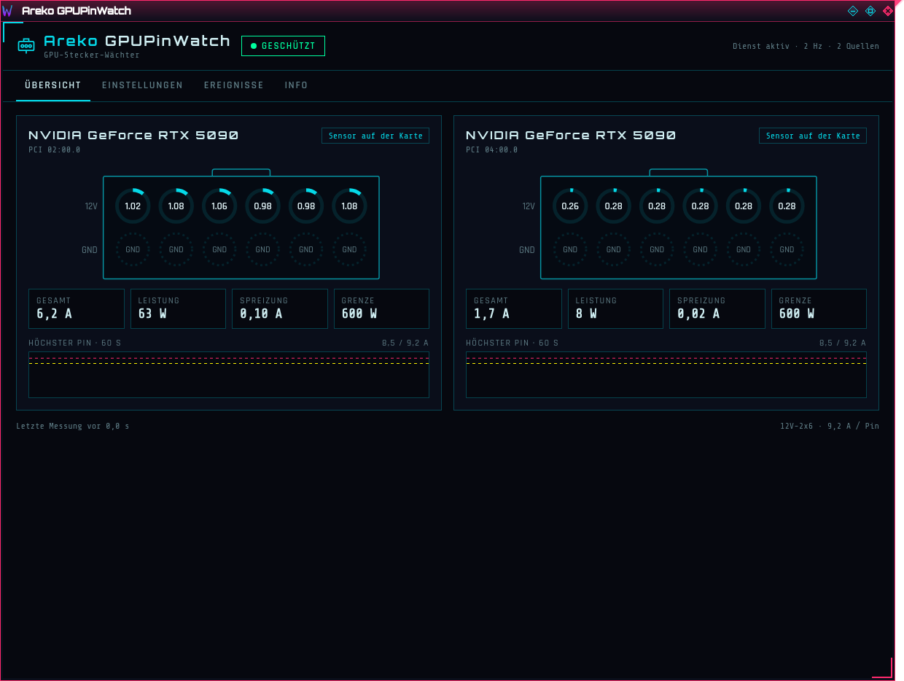
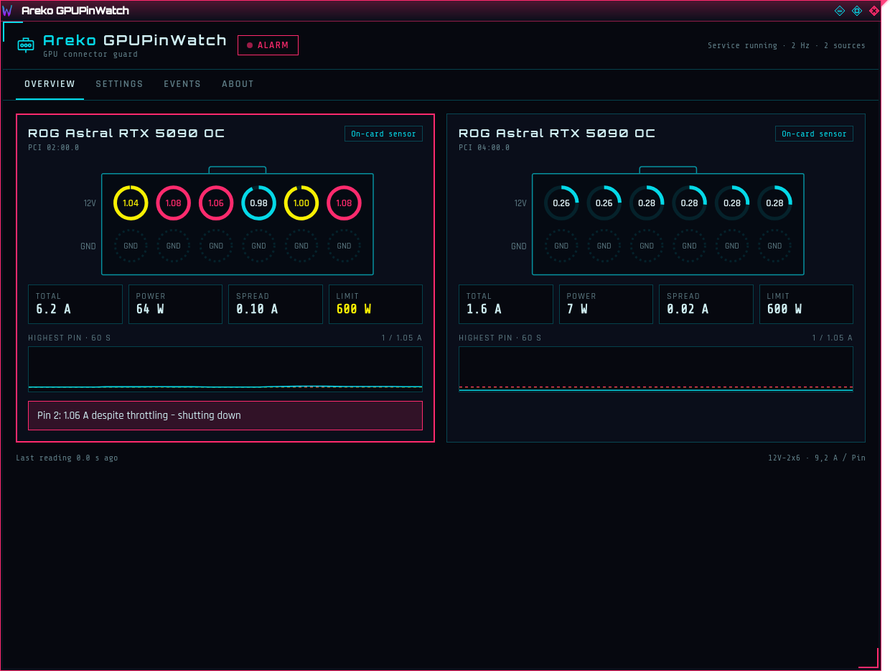
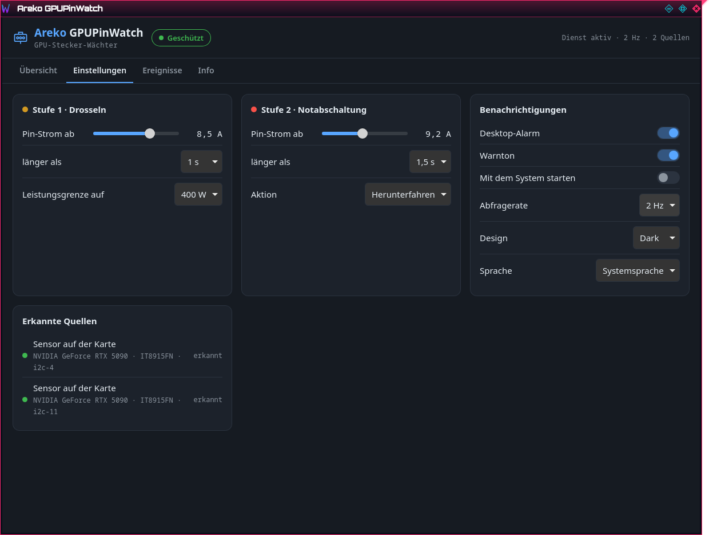
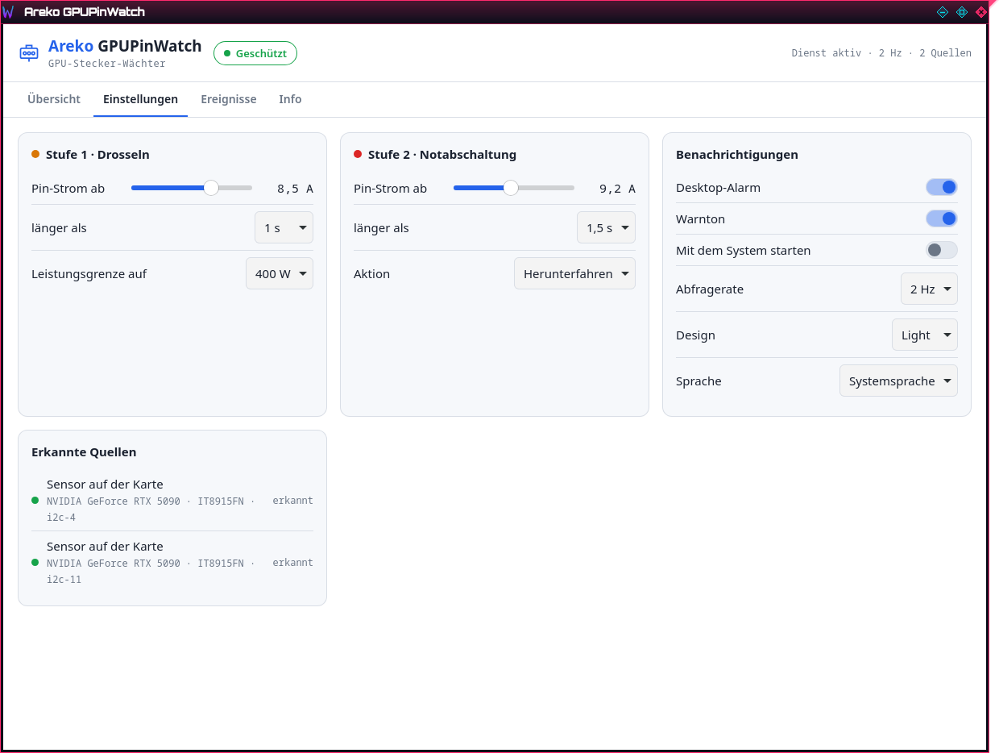

<p align="center"></p>

<h1 align="center">Areko GPUPinWatch</h1>

<p align="center"><b>Per-pin current guard for the 12V-2x6 power connector of RTX 5090 cards – Linux &amp; Windows</b><br>
<a href="README.de.md">Deutsch</a></p>

Melted 12V-2x6 / 12VHPWR connectors usually start with **one pin carrying far more current than the others**
(bad contact, worn plug). Most cards cannot see this: all six 12 V pins end in one copper plane behind the
connector. Areko GPUPinWatch reads the cards and devices that *do* measure every pin and steps in before it gets hot.



## What it does

| | |
|---|---|
| **Watches** | the six 12 V pins of every supported card, 2× per second (1/2/4 Hz) |
| **Stage 1 – throttle** | a pin ≥ **8.5 A** for 1 s → only *that* card's power limit is lowered (default 400 W) |
| **Stage 2 – emergency shutdown** | still ≥ **9.2 A** (the pin rating) for 1.5 s after throttling → the PC shuts down (or alarm only, your choice) and a log file is written |
| **Alarms** | tray icon turns yellow/red and blinks, desktop notification, warning sound, the card in the window pulses red |
| **Release** | one click gives a throttled card its previous power limit back |
| **Window** | overview with plug view (12 V row + GND row), totals, spread, 60 s history, settings, event log |
| **Looks** | themes **Light, Dark, Areko** · languages **English, Deutsch, Italiano, Español, Português, 中文, 日本語** |

All thresholds can be changed in the settings (within safe bounds). The service runs without a logged-in user;
the window is only the display.

| Alarm | Dark | Light |
|---|---|---|
|  |  |  |

## Supported hardware

Per-pin values exist only where hardware measures them. GPUPinWatch detects everything automatically – no setup.

### Cards with an on-card sensor (work with any power supply)

ASUS boards with the ITE IT8915FN monitoring chip. Detection asks the chip itself, so variants not listed here work too.

| Card | PCI subsystem `1043:` | Status |
|---|---|---|
| ROG Astral RTX 5090 OC | 89E3 | ✅ tested (Linux, 2 cards) |
| ROG Astral RTX 5090D OC | 89EA | should work, untested |
| ROG Astral LC RTX 5090 | 89EC | should work, untested |
| ROG Astral RTX 5090 OC White | 8A2E | should work, untested |
| ROG Astral RTX 5090 BTF OC | 8A5A, 8A3C | should work (only when powered through the 12V-2x6 socket) |
| ROG Matrix RTX 5090 | 8A61 | should work, untested |
| ROG Astral RTX 5080 / OC / OC White / Hatsune Miku | 89DF, 89DE, 8A2B, 8A45 | should work, untested |

### Any RTX 5090 with one of these devices

| Device | Connection | Status |
|---|---|---|
| Thermal Grizzly **WireView Pro II** (+ Noctua Edition) | USB (serial) | implemented from the documented protocol, untested on a device |
| MSI **MPG Ai1300TS PCIE5 / Ai1600TS PCIE5** power supply (GPU Safeguard+) | USB (HID), up to 2 connectors | implemented from the documented protocol, untested on a device |

With a WireView or an MSI power supply, GPUPinWatch finds out by itself which card the connector feeds
(it compares the measured current with each card's power draw).

### Not supported – and why

- **Other RTX 5090 boards without one of the devices above** (Founders Edition, TUF, Prime, Gigabyte, Zotac, Palit, PNY,
  Inno3D, MSI Gaming/Vanguard/Suprim, …): the board only measures the *total* current, there is no per-pin data to read.
- **MSI MAG A1000PLS / A1200PLS**: protection is inside the PSU (buzzer), no data over USB.
- **Cooler Master GPU Shield**: measures per pin, but has no USB/software interface.

Ground pins (GND) are never measured by any of these sensors.

## Install

### Windows 10 / 11

1. Download `Areko-GPUPinWatch-<version>-windows-x64.zip` from [Releases](../../releases) and unpack it.
2. Double-click **`install.cmd`** (Windows asks for administrator rights). Alternatively, in an administrator PowerShell:
   `powershell -ExecutionPolicy Bypass -File .\install.ps1`
   This copies everything to `C:\Program Files\Areko GPUPinWatch`, installs and starts the service
   **Areko GPUPinWatch** (starts with Windows) and adds the window to the Start menu.
3. Remove again: double-click **`uninstall.cmd`**.

The files are not signed yet – SmartScreen may ask once ("More info" → "Run anyway").
Settings: `%ProgramData%\Areko GPUPinWatch\config.toml`.

### Linux

Needs the NVIDIA driver (NVML) and, for ASUS cards, the `i2c-dev` module (the installer enables it).

1. Download `Areko-GPUPinWatch-<version>-linux-x64.tar.gz` from [Releases](../../releases) and unpack it.
2. `sudo ./install.sh` – installs the service `areko-gpupinwatch` (systemd, root), the window
   `areko-gpupinwatch` with menu entry, and loads `i2c-dev` at boot.
3. Remove again: `sudo ./install.sh --entfernen`

Settings: `/etc/areko-gpupinwatch/config.toml`. Release a throttled card from the window or with
`sudo systemctl restart areko-gpupinwatch` (restores the previous limit).

### Try it without risk

`areko-gpupinwatchd --probe` runs the full logic but never changes a power limit and never shuts down –
it only logs what it *would* do. With low test values such as `--probe --warn 1.0 --crit 1.05` you can watch both stages fire without real load.

## Build from source

```bash
# Linux: Rust (stable), webkit2gtk4.1, libsoup3, libappindicator-gtk3 (Fedora: *-devel packages)
cargo build --release                       # service + window
sudo packaging/linux/install.sh             # uses target/release
# Windows binaries from Linux: mingw64-gcc + rust-std for x86_64-pc-windows-gnu
cargo build --release --target x86_64-pc-windows-gnu
```

Layout: `crates/gpw-core` (decoders, protection logic, IPC – no I/O), `crates/gpw-sources` (device access),
`crates/gpw-daemon` (service), `app/` (window, Tauri 2). Protocol facts: [docs/PROTOKOLLE.md](docs/PROTOKOLLE.md).
The program only ever sends **read** commands to devices (allow-lists in the code).

## Disclaimer

Areko GPUPinWatch does not replace a properly seated connector and good cables. It reacts to what the sensors
report; it cannot see damage that has already happened. Use at your own risk.

## License

[PolyForm Noncommercial 1.0.0](LICENSE.md) – free for personal and non-commercial use; commercial use only with the
author's permission.

Required Notice: Copyright Areko (https://github.com/arekown/Areko-GPUPinWatch)

Thank you for the protocol groundwork to: vhpwr-guard · LACT · LibreHardwareMonitor · PinSentinel ·
wireview-pro-ii · wireview-monitor · meltalarm · psutop · msi-psu-monitor.
